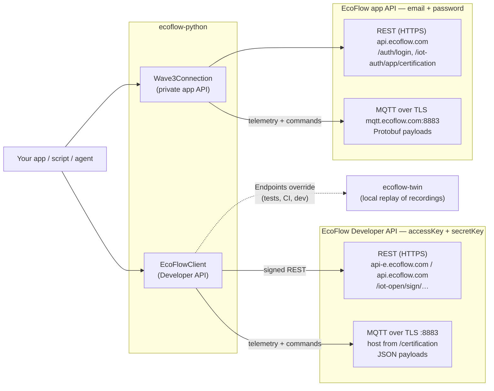
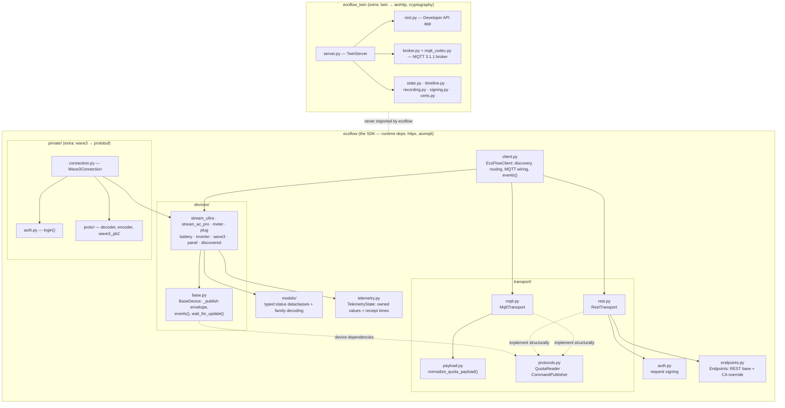
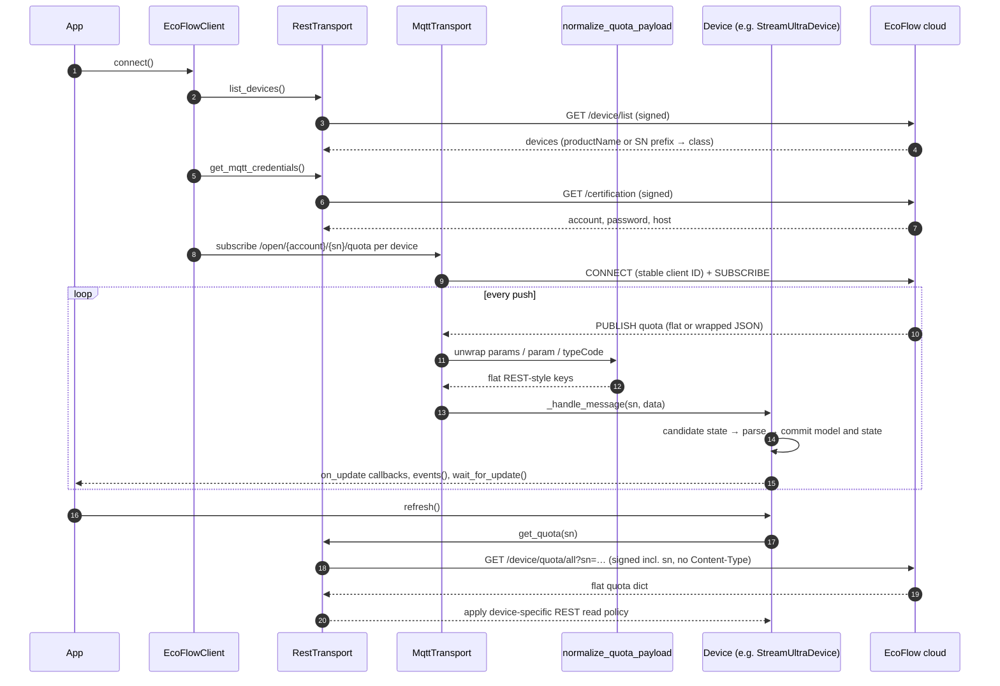
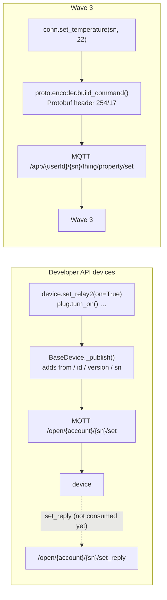
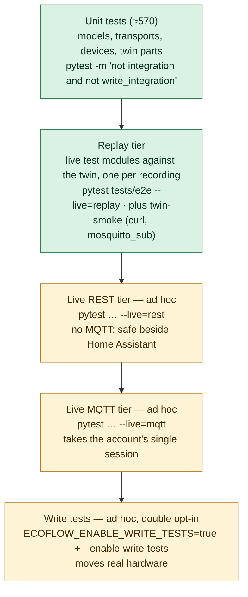
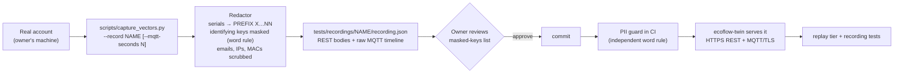

# Architecture

How `ecoflow-python` is put together, how data moves through it, and how it is
tested. The diagrams are Mermaid, so they render on GitHub and diff as text.
Why each piece is the way it is lives in [decisions/](decisions/README.md);
how it got here is in [history.md](history.md).

- [System context](#system-context)
- [Packages and modules](#packages-and-modules)
- [Reading device state](#reading-device-state)
- [Sending commands](#sending-commands)
- [Testing architecture](#testing-architecture)
- [Recording pipeline](#recording-pipeline)
- [Telemetry and lifecycle review](#telemetry-and-lifecycle-review)

## System context

EcoFlow exposes **two unrelated APIs**, and the SDK has one entry point per API
([ADR 0001](decisions/0001-two-separate-api-paths.md)). They share no
credentials, broker, topics or wire format.

| | Developer API (`EcoFlowClient`) | App API (`Wave3Connection`) |
|---|---|---|
| Devices | STREAM Ultra / AC Pro, Smart Meter, Smart Plug, DELTA/RIVER, PowerStream | Wave 3 (the Developer API answers `1006` for it) |
| Auth | HMAC-SHA256 signed REST; MQTT user/password from `/certification` | Login (base64 password) → bearer token → `/iot-auth/app/certification` |
| MQTT client ID | `ecoflow-sdk-<hash(account)>` (stable) | `ANDROID_<hash(userId)>_<userId>` (stable, shape required by the broker) |
| Telemetry topic | `/open/{account}/{sn}/quota` | `/app/device/property/{sn}` |
| Command topic | `/open/{account}/{sn}/set` | `/app/{userId}/{sn}/thing/property/set` |
| Wire format | JSON (flat or wrapped per family) | Protobuf, XOR-obfuscated |

Both brokers allow **one session per account** and about **10 unique client IDs
per account per day**; both refuse with MQTT code 135
([ADR 0002](decisions/0002-stable-mqtt-client-ids.md),
[ADR 0003](decisions/0003-fail-fast-on-first-connect-135.md)).

## Packages and modules

## Reading device state

STREAM and Smart Meter merge partial readings into a `TelemetryState` containing
raw values and their per-field receipt times. Smart Plug keeps a separate MQTT
state while REST refreshes produce a standalone visible view. Other device
families retain their existing read policies. MQTT envelopes are normalised by
the transport; STREAM's model-level helper canonicalises its recorded nested
and flat strategy keys ([ADR 0005](decisions/0005-normalize-mqtt-to-rest-layout.md)).

For these three adapters, an update creates a candidate state and parses it
before replacing the visible model and state together. Rejected readings cannot
poison later updates or refresh field receipt times. The internal state owns
its inputs and returns defensive copies. Public status dataclasses and event
objects remain mutable as before.

`EcoFlowClient(enable_mqtt=False)` stops after discovery: REST reads only, so it
never takes the account's single MQTT session. Smart Meter REST normally returns
an empty quota; its `refresh()` raises `EcoFlowDataUnavailableError` rather than
creating a zero-power reading.

For STREAM, Smart Meter and Smart Plug, `field_received_at` tracks receipt of
normalised raw leaves. Nested partial records preserve unmodified leaves and
their timestamps. Snapshot `updated_at` remains parse time and cannot establish
freshness of each field; receipt times cannot establish device measurement age.
See the [availability and migration notes](../README.md#telemetry-availability-and-freshness).

## Sending commands

STREAM commands also need `cmdId 17 / cmdFunc 254 / dirDest / dirSrc / dest /
needAck`; without them the device ignores the command
([ADR 0006](decisions/0006-command-envelope.md), AGENTS.md Quirk 13).
Command acknowledgements (`set_reply`, Wave 3 `cmd_id 18`) are not surfaced yet —
see [validation-status.md](validation-status.md).

## Testing architecture

Tests are layered by how much of the real world they touch. Only the first two
layers run in CI; nothing in CI talks to EcoFlow
([ADR 0008](decisions/0008-live-tests-ad-hoc-never-ci.md)).

Green layers run in CI on every PR; amber layers run only on a trusted machine
with the owner's credentials in the gitignored `tests/.env`
([live-testing.md](api/live-testing.md)).

## Recording pipeline

Real device behaviour enters CI only as **redacted recordings**
([ADR 0009](decisions/0009-record-replay-as-ci-source-of-truth.md),
[ADR 0012](decisions/0012-pii-policy.md)).

The twin is a behavioural clone at the network boundary: it verifies
signatures independently of the SDK, enforces the one-session and client-ID
rules, and plays the recorded MQTT timeline in a loop
([ADR 0010](decisions/0010-service-digital-twin.md),
[digital-twin.md](api/digital-twin.md)).

## Telemetry and lifecycle review

Review date: 2026-10-30. The scope covers the Developer API client, REST/MQTT
transports, envelope normalisation, device state, typed parsing and offline
contracts. This is a bounded review and refactor, not a claim of blanket SOLID
compliance or new hardware validation.

| Priority | Finding and code evidence | Decision |
|---|---|---|
| High | The former `BaseDevice._merge_telemetry` updated raw values and receipt times before parsing. One invalid number could make subsequent valid partial packets fail. | `TelemetryState.updated()` returns a candidate. STREAM/meter/plug adapters parse before committing; rejected MQTT or REST data leaves the prior state intact. |
| Medium | BaseDevice combined events/command envelopes with caller-owned cache mutation; plug selected sources by aliasing private timestamp dictionaries. | Move recursive merge, ownership and timestamps into `telemetry.py`. Plug composes separate states; source policies remain explicit in each adapter. |
| Medium | STREAM device canonicalisation and `StreamUltraStatus.from_quota_payload` independently encoded flat/nested mode precedence. | Both use `models.stream_ultra.normalize_stream_payload`. Envelope unwrapping remains in `transport.payload`; units stay in the appropriate model parser. |
| Medium | Devices named full REST/MQTT implementations, while client routing used bare `type` and `Any`. | Use small structural `QuotaReader` and `CommandPublisher` interfaces and type the registry/collections against BaseDevice. The client remains the concrete composition root and lifecycle owner. |
| Medium | Client context entry failure leaked resources; failed MQTT cleanup skipped REST closure; cancelling MQTT connect left its task running. | Attempt cleanup on failed entry and both disconnect paths; reuse MQTT cleanup on timeout/cancellation. Keep the initiating error/cancellation, attaching a note for secondary cleanup errors. Preserve stable broker IDs. |

The state helper contains no vendor field mapping, transport or model imports.
Adapters retain the distinctions that must not be combined: empty meter REST
raises `EcoFlowDataUnavailableError`, STREAM refresh preserves pack data, plug
REST/MQTT views remain separate, and plug voltage filtering/units retain their
recorded behaviour. The small repeated parse-and-commit steps in adapters keep
model types and these policies visible; a generic device hierarchy or plugin
registry would add indirection without demonstrated reuse.

Adapters depend on narrow transport capabilities and pure state/model
operations, with `EcoFlowClient` wiring the concrete implementations. The narrow
interfaces can be satisfied by in-memory fakes with no discovery, certification
or lifecycle methods. They do not unify the private Wave 3 Protobuf stack with
the public JSON API. The client's explicit collection routing preserves its
existing public typed lists instead of replacing them with an untyped registry.

Validation includes shared adapter contracts for rejected-payload recovery,
quota errors, timestamps and callbacks; pure nested-state ownership/schema
replacement tests; minimal read/publish fakes; context/task cleanup tests; the
existing zero-versus-missing/source-separation tests; and the recorded-session
suite. Regressions were checked against the previous local patch: five of six
rejected-payload cases and all four lifecycle cleanup cases failed there.
The plug REST rejection case already behaved correctly and remains a contract.
Independent review also caught a secondary cleanup error masking the original
entry failure/cancellation. Shared error-preserving cleanup now handles failed
entry, disconnect and context exit; tests cover simultaneous failures.
Run the repository's ordinary offline unit, replay, lint, format and strict type
commands; no live tier or write test is needed for these internal guarantees.

Deliberate deferrals and limits:

- Existing `daily_energy_wh: float | None` and empty-meter exceptions remain the
  intentional compatibility changes described in the [README](../README.md#telemetry-availability-and-freshness).
  Other numeric defaults and broad per-model availability need a separate API
  migration; `online` still does not establish data freshness.
- Receipt times cannot prove vendor measurement age. Reconnects do not renew
  untouched fields, but no hardware reconnect or broker behaviour was validated.
  Device event queues carry existing mutable models, not historical telemetry
  metadata snapshots; consumers must capture the current map when needed.
- Wave 3's optional REST dependency/public-device facade and incomplete
  PowerStream/panel models remain substitutability/model gaps. Their protocol
  behaviour is not changed by this refactor.
- Client connection-state reporting and command acknowledgements remain gaps.
  No suspect command mappings, power signs or cascade aggregation were changed.
  Manual `connect()` callers still own cleanup; failed `async with` entry now
  cleans up the resources that the context manager owns.
- Transport signing, normalisation and broker retry/ID logic already have
  separate modules. No broader factory framework, persistent queue or service
  layer is introduced without a concrete use case.

## Older diagrams

`docs/diagrams/*.dot|svg|png` are the v0.3.0 (June 2026) diagrams. They predate
the twin, record/replay and the tiered tests, and are kept as a historical
snapshot (see [diagrams/README.md](diagrams/README.md)).
